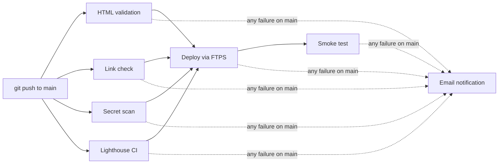

# Gomgom Silalahi – Resume Website

[](https://github.com/gomslhi/projectgomsil-resume/actions/workflows/deploy.yml)

Personal resume site: https://resume.projectgomsil.com

Static HTML/CSS/JS served on Hostinger, deployed automatically with GitHub Actions.

## CI/CD pipeline



| Stage | Tool | Purpose |
|---|---|---|
| HTML validation | htmlhint | Catch broken markup before deploy |
| Link check | lychee | Find dead links and missing assets |
| Secret scan | gitleaks | Prevent leaked credentials |
| Quality audit | Lighthouse CI | Track performance, accessibility, SEO |
| Deploy | FTP-Deploy-Action (FTPS) | Sync changed files to Hostinger |
| Smoke test | curl | Verify homepage, CV PDF and assets after deploy |
| Failure alert | curl (SMTP) | Email me when any stage fails on `main` |


Credentials are stored in GitHub Secrets; the workflow runs with read-only token permissions and a concurrency lock to avoid overlapping deploys.

## Workflow

- `main` is protected by a ruleset: no direct pushes, changes go through a pull request and must pass the HTML, link, secret and Lighthouse checks.
- Deploy and smoke test run only on `main`; pull requests run the checks only.
- Dependabot opens one grouped weekly pull request for GitHub Actions updates.

### Production approval (not enabled)

For a team setup, the `deploy` job can target a `production` environment with required reviewers, so a release waits for manual approval after all checks pass:

```yaml
deploy:
  environment:
    name: production
    url: https://resume.projectgomsil.com
```

Not enabled here since this is a single-maintainer project.

## Local preview

```bash
php -S localhost:8000
```

## Structure

- `index.php` – main page (served by the host)
- `assets/` – CSS, JS, images, CV PDF
- `.github/workflows/deploy.yml` – CI/CD pipeline
