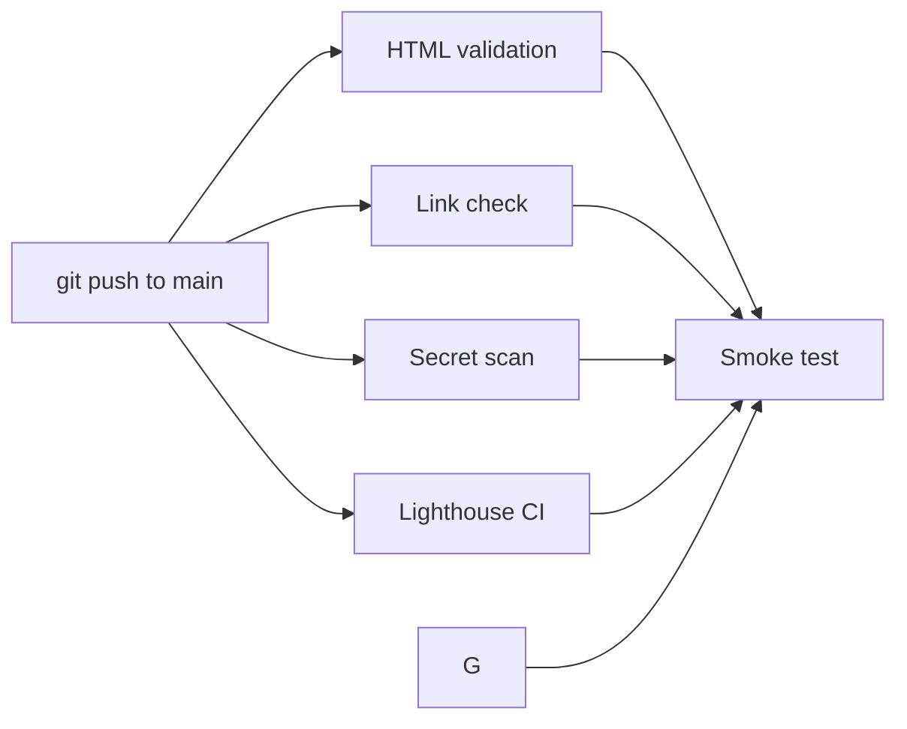

# Gomgom Silalahi – Resume Website

[](https://github.com/gomslhi/projectgomsil-resume/actions/workflows/deploy.yml)

Personal resume site: https://resume.projectgomsil.com

Static HTML/CSS/JS served on Hostinger (PHP hosting), deployed automatically with GitHub Actions.

## CI/CD pipeline



| Stage | Tool | Purpose |
|---|---|---|
| HTML validation | htmlhint | Catch broken markup before deploy |
| Link check | lychee | Find dead links and missing assets |
| Secret scan | gitleaks | Prevent leaked credentials |
| Quality audit | Lighthouse CI | Track performance, accessibility, SEO |
| Deploy | FTP-Deploy-Action (FTPS) | Sync changed files to Hostinger |
| Smoke test | curl | Verify homepage, CV PDF and assets after deploy |


Credentials are stored in GitHub Secrets; the workflow runs with read-only token permissions and a concurrency lock to avoid overlapping deploys.

## Local preview

```bash
php -S localhost:8000
```

## Structure

- `index.php` – main page (served by the host)
- `assets/` – CSS, JS, images, CV PDF
- `.github/workflows/deploy.yml` – CI/CD pipeline